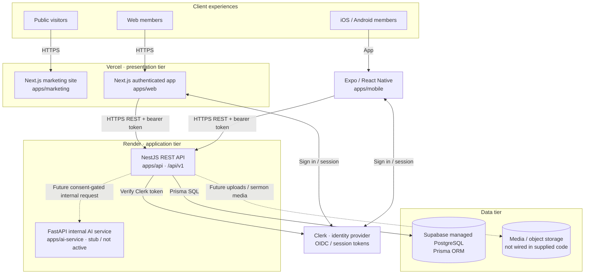
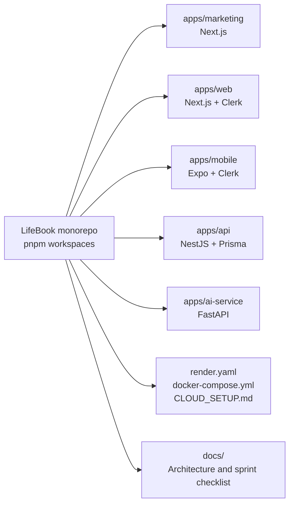
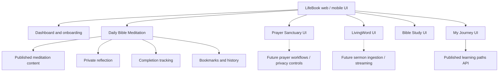
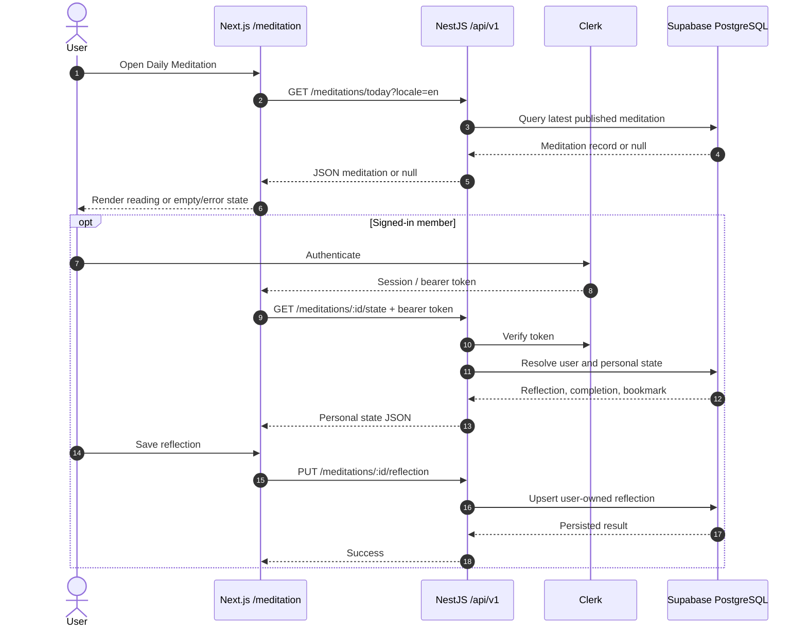
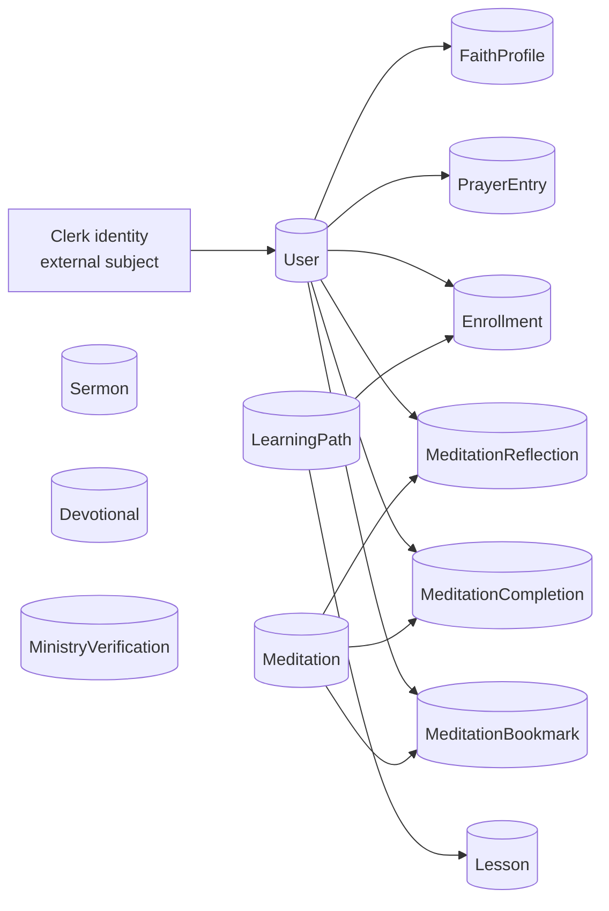
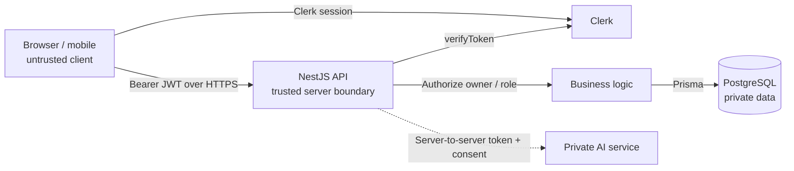
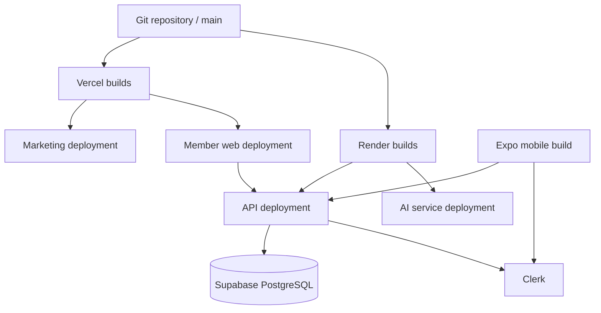
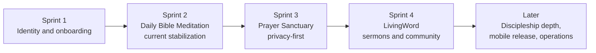

# LifeBook — System Architecture & Engineering README

> **Architecture baseline:** 12 October 2026 · **Repository:** `lifebook` pnpm monorepo · **Status:** Phase 1 / Sprint 2 under integration testing.
>
> This document describes the **code and configuration present in the supplied LifeBook source**. Solid arrows indicate implemented or configured integrations; dashed arrows indicate planned integrations. Deployment and operational readiness are **not** implied by a box appearing in a diagram.

## 1. Product overview

LifeBook is a mobile-first Christian devotional and discipleship platform bringing Scripture, personal reflection, prayer, teaching and user-directed spiritual learning into one experience. The initial release centers on **Daily Bible Meditation**, with **Prayer Sanctuary**, **LivingWord**, Bible Study and discipleship pathways expanding in later releases.

**Product boundaries:** Users select their own faith journey; this is optional personalization, **not** a spiritual-maturity score. Platform permissions and ministry verification are separate from faith journey. AI must not claim divine authority, diagnose spiritual maturity or determine a user's calling.

## 2. Complete high-level architecture



**Key rule:** The NestJS API owns access to private application data. Web and mobile clients should not directly query Supabase Postgres. **Clerk is the only identity provider**; Supabase Auth is not used.

### Logical layers

| Layer | Source | Responsibility | Target |
|---|---|---|---|
| Public web | `apps/marketing` | Landing pages and acquisition | Vercel |
| Member web | `apps/web` | Dashboard, meditation, onboarding, prayer and teaching screens | Vercel |
| Mobile | `apps/mobile` | Native iOS/Android member experience | Expo / app stores |
| Identity | Clerk | Sign-in, sessions, OIDC tokens | Managed service |
| Application API | `apps/api` | Validation, authorization, business logic, data access | Render |
| Data access | Prisma in `apps/api` | PostgreSQL schema and queries | Supabase PostgreSQL |
| AI boundary | `apps/ai-service` | Private FastAPI service; AI generation **not configured** | Render |
| Local infrastructure | `docker-compose.yml` | Local pgvector/Postgres and Redis | Developer machines only |

## 3. Monorepo topology



```text
lifebook/
├── apps/
│   ├── marketing/                # Public Next.js site
│   ├── web/                      # Authenticated Next.js site
│   │   ├── app/                  # App Router pages
│   │   ├── components/           # Shared UI and meditation views
│   │   └── lib/                  # API client
│   ├── mobile/                   # Expo mobile application
│   ├── api/
│   │   ├── src/app.module.ts     # Profile, devotional and path endpoints
│   │   ├── src/meditation/       # Meditation controller and service
│   │   └── prisma/schema.prisma  # Database schema
│   └── ai-service/main.py        # Internal FastAPI stub
├── docs/                         # Project documentation
├── render.yaml                   # Render service definitions
├── docker-compose.yml            # Local Postgres/Redis
├── pnpm-workspace.yaml
├── pnpm-lock.yaml
└── package.json
```

## 4. Application modules and delivery status



| Module | Source-supported implementation | Remaining work |
|---|---|---|
| Authentication / onboarding | Clerk integration; profile GET/PUT endpoints | Verify production keys and end-to-end onboarding |
| Dashboard | Web route exists | Confirm live data and mobile responsiveness |
| Daily Bible Meditation | Public today/detail routes; authenticated reflection, completion, bookmarks, history | Resolve live response-format error; verify published data and integration tests |
| Prayer Sanctuary | Web route and `PrayerEntry` model exist | Full workflows, sensitive-data protection and consent-gated AI |
| LivingWord | Web route and `Sermon` model exist | Media ingestion, playback pipeline, moderation and live events |
| Bible Study | Web route exists | Confirm content provider, licensing and reading/search implementation |
| Discipleship | Web route; published paths endpoint; path/lesson/enrollment models | Program UX and progress integration |
| AI-assisted prayer meditation | Private FastAPI endpoint skeleton | Explicitly returns HTTP 501; LLM/RAG/safety not implemented |

**Important:** A database model or page route does **not** mean the feature is fully implemented.

## 5. Meditation architecture — current priority



### Meditation API contract

Base path: `/api/v1`.

| Method | Route | Access | Purpose |
|---|---|---|---|
| `GET` | `/meditations/today?locale=en` | Public | Latest eligible published meditation |
| `GET` | `/meditations/:id` | Public | Published meditation by ID |
| `GET` | `/meditations/:id/state` | Bearer token | Member's personal state |
| `PUT` | `/meditations/:id/reflection` | Bearer token | Save reflection |
| `POST` | `/meditations/:id/complete` | Bearer token | Mark completed |
| `PUT` | `/meditations/:id/bookmark` | Bearer token | Add/remove bookmark |
| `GET` | `/meditations/history` | Bearer token | Completion history |
| `GET` | `/meditations/saved` | Bearer token | Saved meditations |

**Known incident:** The deployed meditation page has displayed **“Unexpected API response format.”** The source alone does not prove whether the live failure is a non-JSON response, URL misconfiguration, deployment issue or missing content. Inspect the live request status, response headers/body and API logs before changing the database.

## 6. Data architecture



Models present in `apps/api/prisma/schema.prisma`: `User`, `FaithProfile`, `Devotional`, `PrayerEntry`, `Sermon`, `LearningPath`, `Lesson`, `Enrollment`, `MinistryVerification`, `Meditation`, `MeditationReflection`, `MeditationCompletion`, and `MeditationBookmark`. Enums include `FaithJourney`, `PlatformRole`, and `VerificationStatus`.

- `User.oidcSubject` links internal users to Clerk identity.
- Faith journey is stored separately from authorization roles.
- Private meditation state is linked to the authenticated internal user.
- Use Prisma migrations for schema changes; do not manually change production tables without a migration plan.
- Production database is intended to be Supabase managed PostgreSQL, with pooled `DATABASE_URL` and direct `DIRECT_URL` for relevant Prisma operations.

## 7. Authentication, authorization and trust boundaries



**Security principles**

1. Verify Clerk bearer tokens **server-side**; never trust a client-provided user ID as authorization.
2. Scope private reflections, bookmarks, prayer entries and progress by the authenticated internal user.
3. Keep `CLERK_SECRET_KEY`, database credentials and AI internal secrets on server environments only.
4. Require explicit user consent before transmitting prayer text to any AI processor.
5. Treat reflection and prayer content as sensitive. The supplied architecture does **not** establish application-level encryption, retention/deletion workflows or production-grade privacy controls.
6. Add rate limits, request size limits, audit logging, abuse protections and automated security tests before launch.
7. Keep platform roles and verified ministry status separate from self-selected faith journey.

**Configuration discrepancy to resolve:** `render.yaml` sets `AI_INTERNAL_API_KEY`, while `apps/ai-service/main.py` checks `AI_INTERNAL_TOKEN`. Align these names before enabling internal AI calls. The endpoint currently intentionally returns `501 Not Implemented` after consent and token checks.

## 8. Deployment architecture



**Vercel:** Create separate projects with root directories `apps/marketing` and `apps/web`. Configure `NEXT_PUBLIC_API_URL` for the web app and Clerk publishable key. The frontend must call the correct `/api/v1` base path exactly once.

**Render:** `render.yaml` defines `lifebook-api` and `lifebook-ai`. API health path is `/api/v1/health`. Supply server-side database and Clerk configuration. AI service has `/health` but no configured generation provider.

**Mobile:** Expo app is in the monorepo; configure `EXPO_PUBLIC_API_URL` and Clerk public settings. App store releases and EAS pipelines are not established by the reviewed files.

**Local development:** `docker-compose.yml` offers PostgreSQL with pgvector and Redis. This does **not** mean Redis is integrated into the production API request path.

### Environment variable map

| Service | Variables / examples | Notes |
|---|---|---|
| Web | `NEXT_PUBLIC_API_URL`, `NEXT_PUBLIC_CLERK_PUBLISHABLE_KEY` | Public build-time values; no secrets |
| Mobile | `EXPO_PUBLIC_API_URL`, Clerk publishable key | Public mobile values |
| API | `DATABASE_URL`, `DIRECT_URL`, `CLERK_SECRET_KEY`, `CLERK_AUTHORIZED_PARTIES`, `CORS_ORIGINS`, `PORT` | Server-only |
| AI | `AI_INTERNAL_TOKEN` (code), `AI_INTERNAL_API_KEY` (Render YAML) | **Mismatch — resolve before use** |

Do not commit `.env`, `.env.local`, database URLs, Clerk secrets or other credentials.

## 9. Local setup and commands

Requirements: Node.js 20, pnpm 9, Python 3.11+; Docker optional.

```bash
corepack enable
pnpm install

# Configure root and app-specific environment files from examples.
# Configure Supabase pooled and direct connection strings.
pnpm db:generate
pnpm db:migrate  # local/staging only; use deploy migrations in production

# Separate terminals
pnpm dev:api
pnpm dev:web
pnpm dev:marketing
pnpm --filter @lifebook/mobile start

# AI service (development stub)
cd apps/ai-service
pip install -r requirements.txt
uvicorn main:app --reload
```

Build web:

```bash
pnpm --filter @lifebook/web build
```

API health check after deployment: `GET /api/v1/health`.

## 10. Operational request paths

| Scenario | Request path | Sensitive? |
|---|---|---|
| Anonymous daily reading | Web → public API → PostgreSQL | Public content |
| Save reflection | Web → Clerk bearer token → API owner check → PostgreSQL | **Yes** |
| View history | Web → authenticated API → PostgreSQL | Private progress |
| Onboarding | Web/mobile → authenticated profile API → PostgreSQL | Personal profile |
| AI prayer meditation (future) | Client → API consent check → private AI service | **Highly sensitive**; not implemented |
| Sermon playback (future) | Client → media delivery service/CDN | Content/licensing controls pending |

## 11. Production-readiness checklist

- [ ] Resolve the live meditation **unexpected response format** error using actual network response and backend logs.
- [ ] Ensure published meditation records exist for supported languages.
- [ ] Confirm web build passes on the same commit deployed by Vercel.
- [ ] Test public and authenticated meditation endpoints end-to-end.
- [ ] Test Clerk production instance and API JWT verification together.
- [ ] Verify all private queries enforce per-user authorization.
- [ ] Add appropriate protection, retention and deletion for reflections and prayers.
- [ ] Align AI internal secret configuration; keep AI generation disabled until reviewed.
- [ ] Add automated API, integration, accessibility and end-to-end tests.
- [ ] Verify responsive UI, dark mode, keyboard access and loading/empty/error states.
- [ ] Establish production monitoring, structured logs, backups and incident response.
- [ ] Review Bible text rights, sermon permissions and content moderation.

## 12. Roadmap (proposed, not implemented)



**Phase 1:** Centrally curated LifeBook discipleship programs, self-selected faith journey and optional learning personalization. **Phase 2:** Church/pastor-managed programs and mentorship, with separate role verification and safeguarding.

## 13. Source-of-truth files

- `README.md` — original monorepo setup and project overview.
- `docs/ARCHITECTURE.md` — source architecture boundaries and known gaps.
- `render.yaml` — Render service declarations.
- `apps/api/src/app.module.ts` — API composition, identity, profiles, devotionals and paths.
- `apps/api/src/meditation/` — meditation API behavior.
- `apps/api/prisma/schema.prisma` — persisted models.
- `apps/ai-service/main.py` — AI stub, consent requirement and HTTP 501.
- `apps/web/app/` — current web routes.
- `docker-compose.yml` — optional local Postgres/Redis.

---

**Document note:** This is an architecture README based on the supplied repository snapshot. It deliberately distinguishes implemented code from planned services and does not assert that live deployments or all user flows are healthy.
